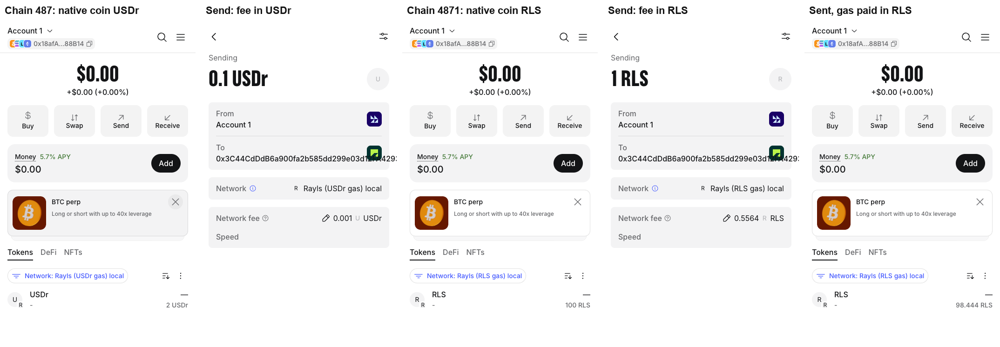

# RLS-flavour transactions (proof of concept)

The node accepts a second chain id, the **RLS flavour**: an explicit one per network (`RLS_CHAIN_IDS`:
487 → 4871 locally, 503 → 50301 on devnet, 7295799 → 72957991 on testnet, 72957 → 729571 on
mainnet). A transaction signed for it pays gas in RLS, and its `value` moves RLS.
USDr stays the only native token; a transaction signed for the chain's own id works exactly as
today. Plain MetaMask on the RLS chain id shows RLS as the native coin, its Send button moves RLS,
dapps see the user's own address, and nothing needs a relayer, approval or gas station.

**Status: proof of concept, not for merge.** Built on axyl `main` (`1970747`). Every check below ran
on a fresh local 4-validator chain built from this branch, with the real rate of ~552 RLS per USDr.



Video: [`demo/metamask-rls-gas.mp4`](demo/metamask-rls-gas.mp4). Real MetaMask 13.56.0 pays gas
in USDr on chain 487, switches to chain 4871 and pays gas in RLS from the same account.

## How it works

| File | Change |
|---|---|
| `crates/execution/evm/src/rls_flavour.rs` (new) | RLS chain id, RLS base fee (USDr base fee × `RLS_PER_USDR`), RLS balance slots, `Transfer` log, unit tests |
| `crates/execution/evm/src/evm/mod.rs` | `transact_raw`: a tx signed for the RLS chain id runs with gas price and value 0. CHAINID = RLS chain id, base fee 0 for that tx |
| `crates/execution/evm/src/evm/handler.rs` | revm `Handler` hooks: check the sender holds gas limit × signed max fee + value in RLS (EIP-1559's rule), take gas limit × effective price + value before execution (checked arithmetic), refund unused gas, pay gas to the RLSAccumulator |
| `crates/execution/evm/src/txn_pool.rs` | See below |
| `etc/rls-flavour/rpc-proxy.mjs` | Wallet-facing RPC for the RLS chain id (balance and gas prices in RLS). Production would serve this from the node |

`RlsFlavourValidator` in `txn_pool.rs` wraps Reth's validator via `TransactionValidationTaskExecutor::map`:
- RLS-chain-id transactions are checked against the sender's RLS: nonce, gas, a fee at or above the
  current RLS base fee, and RLS covering this transaction plus the sender's other waiting RLS
  transactions.
- Their USDr `cost` is set to 0.
- A same-nonce replacement that switches flavour is refused.
- A task after each block (on the blocking pool) drops waiting RLS transactions that can no longer
  execute: unpayable, fee cap under the RLS base fee, or a value recipient that has gained code.
  Nonces the sender has already used are skipped, both there and in the admission sum.

Further points:
- **No Reth fork and no second native token.** All changes use extension points Reth and revm already
  provide.
- **RLS stays a Solidity contract.** The node writes its OpenZeppelin `_balances` slots, as the
  `RlsStorage` hardfork does.
- **The flavour is part of what the user signs.** Every path that re-executes a transaction (sync,
  replay, tracing) sees it.

## Run it

```sh
cargo build --release --bin rayls-network
cd etc/test-network
cp .env.example .env && sed -i '' 's/^RAYLS_NETWORK="devnet"/RAYLS_NETWORK="local"/' .env
cp ../rls-flavour/rls-accounts.yaml .   # Anvil account #1: 1,000 RLS, no USDr
./local-testnet.sh --start --dev-funds 0xf39Fd6e51aad88F6F4ce6aB8827279cffFb92266
UPSTREAM=http://127.0.0.1:8543 node ../rls-flavour/rpc-proxy.mjs &   # RLS chain id on :8645
cd ../rls-flavour
NODE=http://127.0.0.1:8543 ./spike-test.sh && NODE=http://127.0.0.1:8543 ./stress-test.sh && NODE=http://127.0.0.1:8543 ./stress-test-2.sh
```

The genesis is chain 487, so `RAYLS_NETWORK` must be `local`. The keys in the scripts are Anvil's
public dev keys. `demo/record-metamask.mjs` drives MetaMask with Playwright. The extension path and
`demo/test-dapp.html` (served on `127.0.0.1:5199`) are set inside it.

## Results (2026-11-11, this branch)

| Area | Check | Result |
|---|---|---|
| Basics | Native send of 1 RLS from an account with 0 USDr | Recipient +1 RLS; sender paid 21,000 × 26,496 gwei = 0.556 RLS; USDr untouched; two RLS `Transfer` events: the value, and the gas paid to the fee recipient |
| | Dapp call (`approve`), contract deploy, legacy type-0 tx from the RLS chain id | Work; `msg.sender` is the user; gas in RLS |
| | USDr transactions | Unchanged |
| EIP-712 | CHAINID | 4871 in RLS-flavour txs, 487 in USDr txs |
| | RLS permit signed for 4871 | Works in an RLS-flavour tx, reverts in a USDr tx |
| EIP-7702 | Type-4 tx from the RLS chain id, authorization for 4871 | Account delegated (`0xef0100…`); gas in RLS |
| | Calling the delegated account in an RLS-flavour tx | Delegate code runs; CHAINID 4871 |
| | Authorization for 487 inside an RLS tx, or for 4871 inside a USDr tx | Ignored, as for any wrong-chain authorization |
| | Authorization for chain 0 | Works in either flavour (undelegate verified) |
| Nonce | Same nonce in both flavours, either order | Second is refused: "a transaction with this nonce is waiting on the other Rayls network…" |
| | MetaMask (see below) | Takes nonces in order across both networks and handles one network's confirmations at a time |
| Pool | Two RLS sends that each fit but together exceed the balance | Second refused at admission |
| | RLS txs staged in reverse nonce order behind a gap, together more than the balance | Only the first is admitted; after the gap is filled, nothing unpaid is sealed |
| | A waiting RLS send made unpayable by an ERC-20 transfer | Dropped from the pool after the block (no stuck tx) |
| | RLS paused (`RLS.pause()`) | RLS sends refused at the pool (and in the handler); work again after `unpause()` |
| | Fee under the RLS base fee; sender without RLS; RLS value to a contract or a precompile (`0x0400`); RLS value in a type-4 tx | Refused |
| | 21,000 gas with 2 KB of calldata (intrinsic gas) | Refused at the pool, by the same stateless checks reth runs (size, init code, gas caps, tip ≤ fee cap, min tip, 7702 auth list, intrinsic gas) |
| | A waiting RLS tx whose fee cap falls under the RLS base fee | Dropped after the block (same task as the balance re-check) |
| | A waiting RLS value tx whose recipient gets an EIP-7702 delegation | Dropped after the block |
| | `value = 2^256-1` | Refused (overflow checked) |
| Consensus | 120 txs from 3 senders, alternating flavours, sent at once | 120/120 mined, 0 reverted; 4 of 5 blocks held both flavours |
| | State roots | Identical on 4 validators + observer |
| | Observer wiped and re-synced from genesis | All 71 non-empty blocks identical (58 with RLS txs, 157 RLS txs incl. 7 type-4, 8 mixed blocks) |
| Tracing | `debug_traceTransaction` of an RLS-flavour tx | Same gas as the receipt (34,182) |
| | `eth_estimateGas` vs actual (`approve`) | 34,541 vs 34,182 |
| Tests | `cargo test --release -p rayls-execution-evm --lib` | 238 passed (218 existing + 20 new: RLS chain ids, the pause slot, `rls_gas` pricing, max-fee affordability, refusals (pause, contract/precompile recipient, type-4 value), the chain id and base fee restored for a USDr tx after an RLS one, and RLS conservation through `transact_raw` for a send, a revert, a gas refund and a failed debit) |
| | `review-checks.sh` (review fixes on #386, all rounds) | 16/16 |

### Real MetaMask

Official MetaMask 13.56.0, in a disposable headless Chromium driven by Playwright. MetaMask created
a fresh wallet itself, funded on the devnet with RLS (and USDr for the switching test). No key was
imported.

| Step | Result |
|---|---|
| Add chain 4871 (`wallet_addEthereumChain`, ticker RLS) | Plain "Add network" prompt, no warnings |
| Home | "100 RLS" as the native balance |
| **Main Send button**, 1 RLS | Confirm screen "Sending 1 RLS · Network fee 0.5564 RLS"; mined; matches the chain |
| Send **Max** | 95.31 RLS (balance − fee); balance exactly 0 |
| Dapp `approve` | "Spending cap request · Network fee 1.3695 RLS"; allowance set from the MetaMask account |
| `eth_signTypedData_v4` permit for 4871 | Signed; works relayed in an RLS-flavour tx |
| Typed data for 487 while on 4871 | MetaMask refuses ("must match the active chainId") |
| Both networks added | Separate entries; USDr fee 0.001 USDr on 487, RLS fee 0.5564 RLS on 4871; nonces 2 then 3 |
| Queue sends on both networks at once | MetaMask warns "Switching networks will cancel all pending confirmations"; one at a time |
| RLS value to a contract | Blocked before signing: "Network fee Unavailable" + "Review alert" |
| `wallet_watchAsset` for RLS on 4871 | Allowed, then **RLS shows twice**. Integrator docs must say not to add it |

## What this does not do yet

1. **Fork gate (required).** It's active from genesis. Before this change a validator skips any
   tx signed for an RLS chain id as invalid; after it, the tx executes. Mixed-version validators,
   or re-executing history that contains such a tx, would diverge. Gate `rls_gas` and the pool
   behind a `RaylsHardFork`.
2. **Gas price inside the EVM.** BASEFEE (and GASPRICE) read 0 inside RLS-flavour txs. Divide the
   signed fee fields by the rate before revm instead, so they keep their USDr meaning.
3. **Rate and fee recipient are constants.** Read the rate from onchain config, governance-set and
   whole-number ≥ 1, and refuse 0 when it's set: a rate of 0 makes RLS gas free and would turn
   the `effective_tip_per_gas(...).expect(...)` in `reth_env/execution.rs` into a consensus-path
   panic. Pay the fee to FeeAggregator / validators with the RLS split. The node
   always credits the fixed `RLS_TOKEN`, while `RLSAccumulator.setRlsToken` can repoint the
   accumulator to another token; read the token address from the same config.
4. **Receipts and gas suggestions.** The node's `effectiveGasPrice` for RLS txs uses the USDr base
   fee, and RLS tips appear in USDr `eth_feeHistory`. Both need to filter or convert by chain id in
   the node RPC; the proxy fixes receipts only. Tip suggestions are mixed too: the node's reward
   percentiles take RLS-flavour txs' tips in RLS units and USDr txs' tips in USDr units. The proxy
   passes them through unconverted (scaling them would compound 552× per round once RLS txs fill
   blocks), so on USDr-heavy blocks MetaMask's suggested RLS tip is ~552× too small: with
   `--txpool.minimum-priority-fee` set, the pool's scaled minimum would refuse those txs.
   `eth_gasPrice` scales only the base fee and adds the same tip. The reverse hits USDr wallets on the plain RPC: a block of legacy RLS
   txs makes the suggested USDr tip ~551× the base fee, and `feeHistory.reward` is uncapped. The RLS `Transfer` logs are added to the journal
   directly, so inspector `log` hooks don't see them: `callTracer` with `withLog` shows fewer logs
   than the receipt.
5. **Writes to RLS storage.** `RLS.pause()` is enforced: the handler, the pool and the after-block
   re-check read OZ's ERC-7201 `Pausable` slot and refuse RLS-flavour txs (gas included) while it's
   set. Before this, a native RLS send went through while RLS was paused (shown on a local
   devnet). A paused token refuses zero-value RLS-flavour calls too, so an admin must send
   `RLS.unpause()` from the USDr network (the integrator and ops docs must say so). Still bypassed: any other logic in `RLS._update` (hooks, a future blocklist). Add an
   implementation guard (refuse if the proxy's implementation isn't a known one), and coordinate
   RLS upgrades with node releases.
6. **USDr precompile (`0x0400`).** Its EIP-712 domain is fixed at node start, so USDr EIP-3009
   signatures made on the RLS chain id don't verify.
7. **Pool ordering.** Tips in RLS units sort against tips in USDr units.
8. **Explorer.** Blockscout and indexers must read the tx `chainId` to label RLS sends and fees.
   Traces don't help them: the inspector sees the transaction after `rls_gas` zeroed it, so
   `callTracer` reports an RLS send's top frame as `value: 0x0` (and misses the RLS `Transfer`
   logs). Explorers that build native transfers from traces will show RLS sends as 0-value calls.
9. **Check-then-insert races.** Reth validates transactions on several tasks at once, and two
   pool checks here read the pool before the transaction is in it: the cross-flavour nonce guard,
   and the sender's RLS balance against their other waiting RLS transactions. Two transactions
   from one sender validated at the same moment can both pass either check, for example nonces n
   and n+1 that together overspend (`stress-test.sh` C only covers them arriving one after the
   other). The after-block re-check drops the unpayable one, but until then it can be packed and
   skipped at execution without paying. Both checks belong in the pool's insert path, or RLS
   validation needs a per-sender lock held across validate and insert. Admission counts every
   other waiting RLS tx from the sender, later nonces included. Counting only earlier ones would
   let txs submitted in reverse nonce order each pass against the full balance and then be sealed
   together once a gap is filled. The cost: a lower nonce can be refused while a later one waits
   behind a gap; the user replaces the later one, or waits for it to be evicted. Reth's USDr pool
   avoids both by re-checking every descendant on insert; the production version should do that.
10. **RLS chain ids must stay unique.** If another chain uses a network's RLS id, a transaction a
    user signs there is also a valid RLS-flavour transaction here (same key, matching nonce) and
    moves RLS. A derived `chain_id * 10 + 1` already collided: devnet's 5031 is Somnia Mainnet. The
    ids are now an explicit table (`RLS_CHAIN_IDS`), each unused on chainlist on 2026-11-12, with a
    unit test that they're unique and not on a list of known taken ids. All four must be
    registered on chainlist before anyone relies on them; an unknown chain has no RLS flavour.
11. **Failed transactions and indexers.** A reverted or halted RLS tx still pays its gas, and its
    `value` has already moved before execution, but a failed receipt keeps no logs, so neither
    `Transfer` is visible. Indexers that rebuild RLS balances from events drift. Fix: emit the logs
    outside the reverted frame, or have indexers read balances.
12. **Gas differs between flavours.** The handler debits the sender's RLS balance slot before
    execution, so in an RLS tx that slot is warm and dirty, and the `RLS_TOKEN` account is warm. An
    `RLS.transfer` from the sender then costs ~200 gas for that slot instead of ~5,000 (cold
    `SLOAD` 2,100 + clean `SSTORE` 2,900), plus ~2,500 less when a contract calls RLS internally.
    The pause check also reads RLS's `Pausable` slot before execution, so the `paused()` read in
    `RLS._update` is warm in an RLS tx (100 gas) and cold in a USDr one (2,100): another ~2,000 per
    RLS call. Deterministic on every node, but an estimate made in the other flavour is off by up
    to ~5,000 gas per slot written, plus ~2,500 for the account and ~2,000 for the pause slot. Simulation without a gas price writes
    the same balance back, so the slot is warm but not dirty: an RLS `eth_estimateGas` for a call
    that writes the sender's RLS balance comes out a little above the real RLS execution (the safe
    direction, not estimator error).
13. **Re-check cost.** The after-block task walks only senders the validator admitted RLS txs
    for (untracked a minute after their last one leaves the pool), so a block with no RLS txs
    waiting costs nothing. With many RLS senders waiting it still reads each one's state every
    block; limiting it to senders touched by the block is the next step.
14. **RLS spent by USDr-flavour txs (DoS).** The pool only sees RLS spent by RLS-flavour txs. A
    USDr tx from the same sender (`RLS.transfer`), or a third party through `transferFrom`, can
    drain the RLS that waiting RLS txs were admitted against. Example: nonce 0 is a USDr
    `RLS.transfer(alt, B)`, and nonces 1..N are RLS sends that together fit `B`. All are sealed in
    one batch; nonce 0 runs, and 1..N fail the handler's balance check and are skipped without
    paying. The re-check drops them only after the block, and `alt` sends the RLS back for the next
    round, so each round wastes up to `max_account_slots − 1` batch slots for one USDr tx's gas.
    The pool can't close this; the fix is on the execution side. The batch builder must simulate
    RLS txs before they take a slot, against the batch's own earlier txs (the draining USDr tx is
    usually in the same batch), not only the latest state. That also covers `transferFrom`.
    Charging a skipped RLS tx's intrinsic gas in USDr would work too, but brings back the USDr
    requirement for the 0-USDr users this flavour exists for. Bumping its nonce only stops the same
    tx being sealed again: the attacker signs new txs every round, so it bounds retries, not the
    DoS. A cheaper partial fix: never seal a sender's RLS txs after one of their USDr txs in the
    same batch, so the self-drain needs two batches and the re-check catches it (not
    `transferFrom`).
15. **Execution fallback.** The pool re-check catches the known ways an RLS tx becomes
    unexecutable. A tx that still fails the handler's checks at execution is skipped without paying
    and waits until it's dropped. Dropping it in `execute_batch` would close this generally.
16. **Delegated accounts can't receive native RLS.** An EIP-7702-delegated EOA has code
    (`0xef0100‖address`), so a native RLS send to it is refused. That includes MetaMask smart-account
    users, whom MetaMask prompts to upgrade: their wallet shows RLS sends to them as failing. They
    can still receive RLS as an ERC-20 `transfer`. Type-4 transactions can't carry RLS value either,
    because revm applies their authorizations after the recipient check. The precompile rule also
    refuses the burn address `0x…dead`. Integrator docs must say all this.
17. **Not measured.** State-root cost at mainnet load; MetaMask Mobile.
